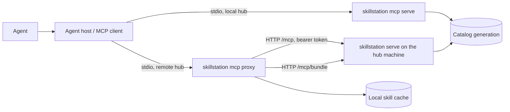
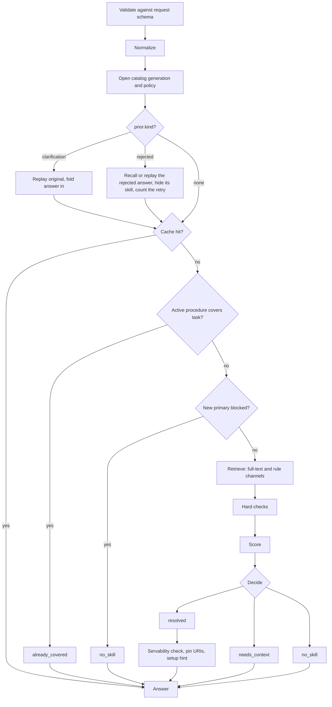
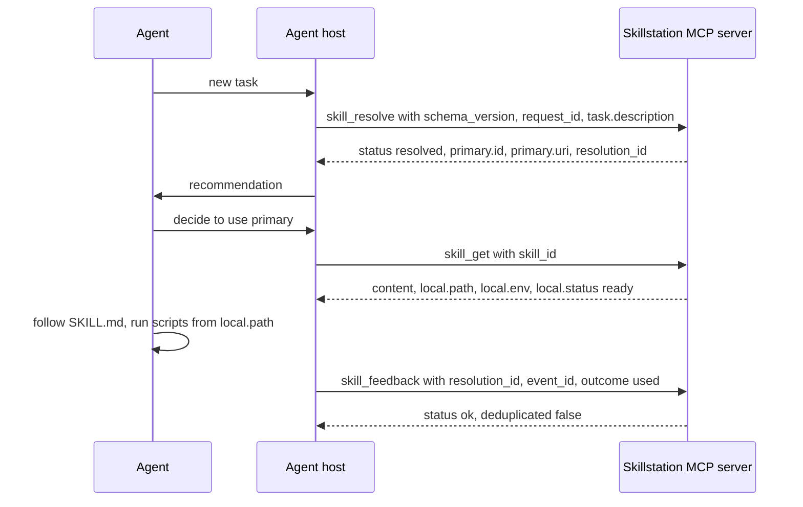
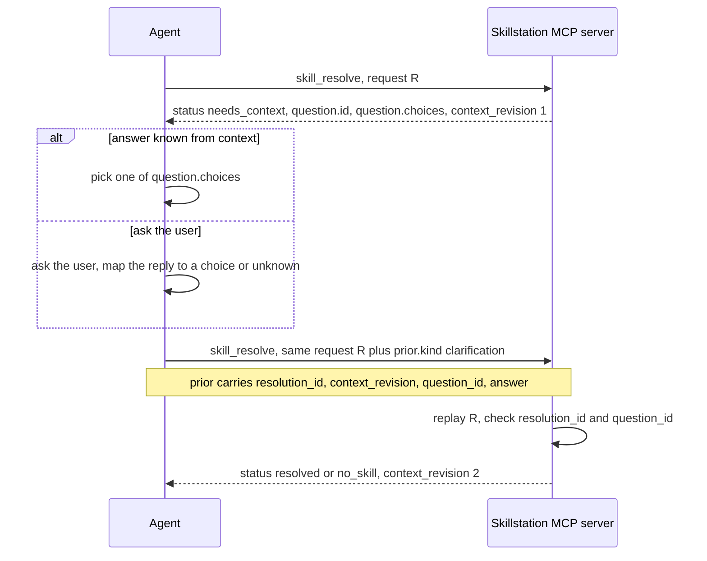
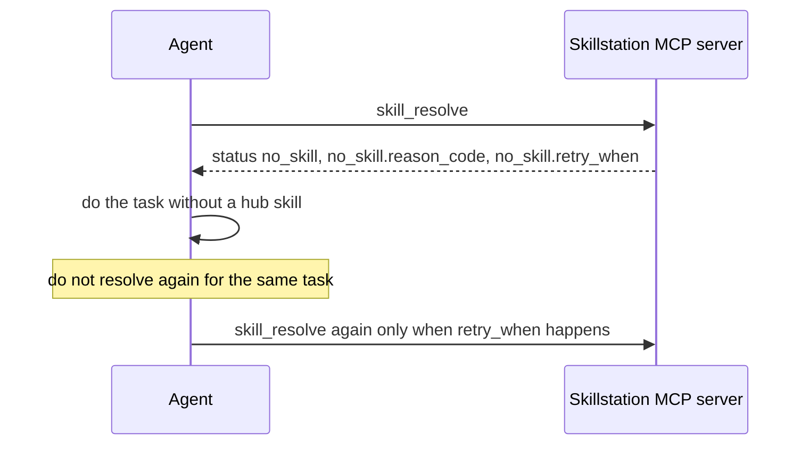
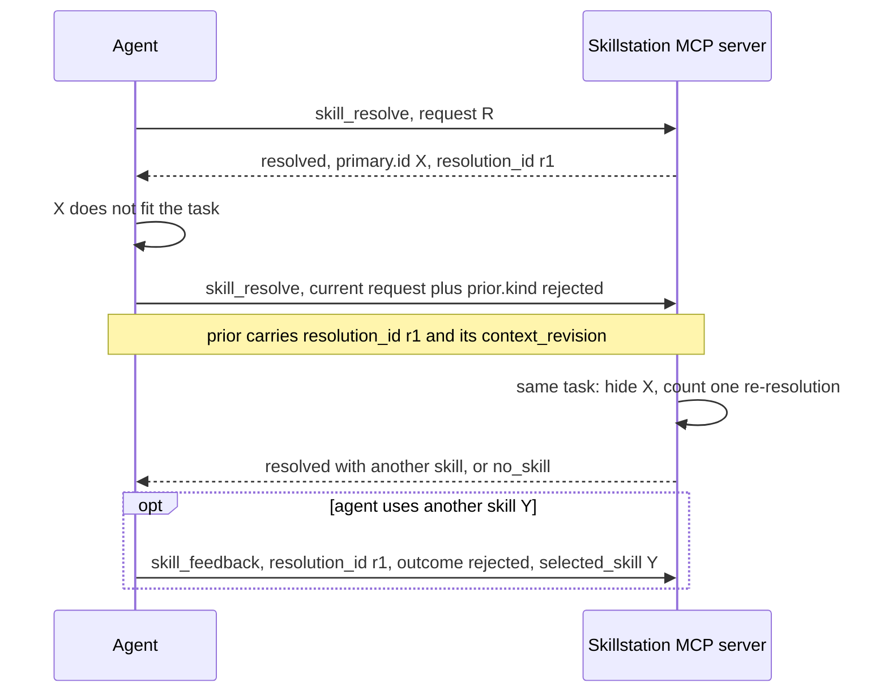
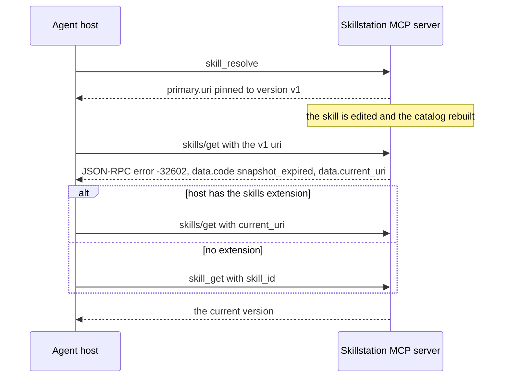
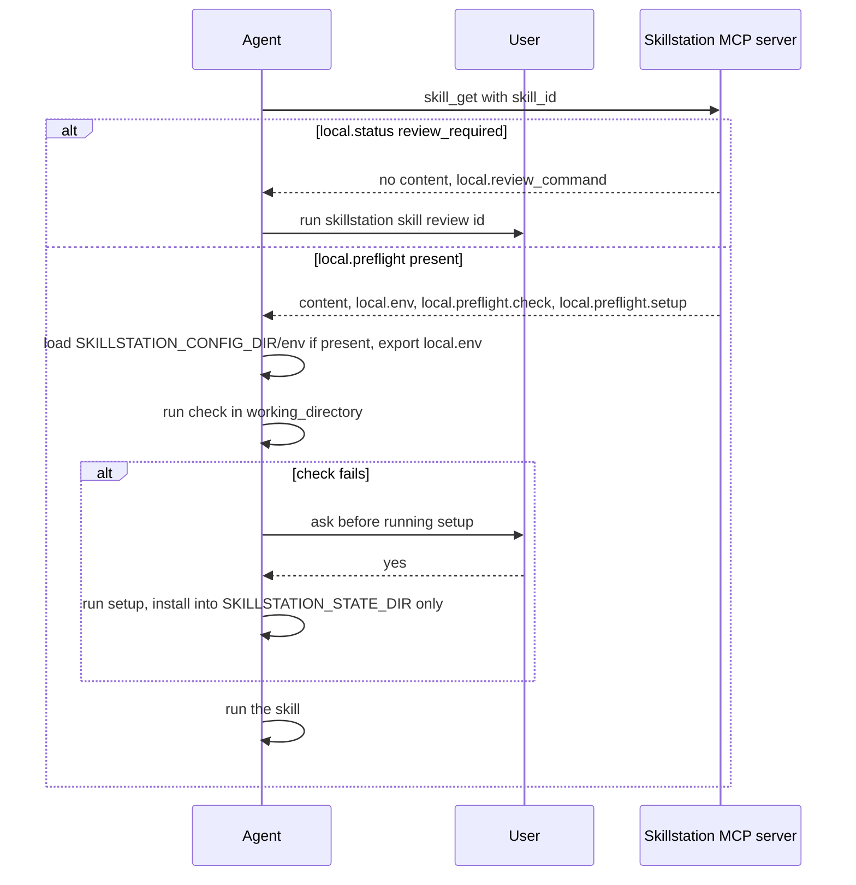
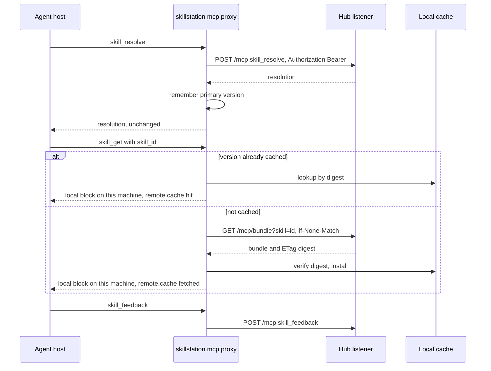
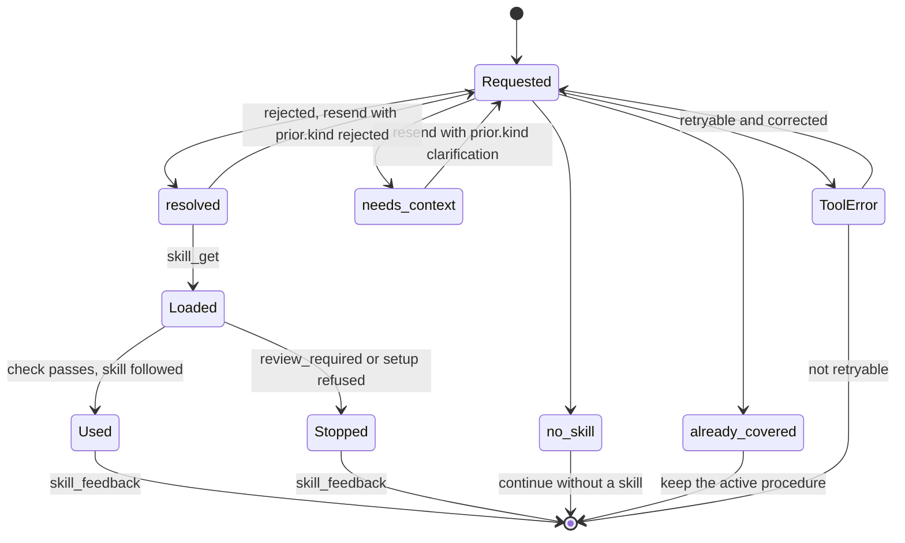

# The `skill_resolve` protocol

This page describes how an agent and Skillstation talk when the agent asks
which skill to use for a task. It covers the messages, the order of the calls,
every response and what the agent does next.

The design reasons live in [Agent–Hub protocol](../design/02-agent-hub-protocol.md)
and [Resolver design](../design/03-resolver-design.md) (both in Vietnamese).
The JSON Schemas are the machine authority:
[request](../../schemas/skill-resolve-request-v1.schema.json) and
[response](../../schemas/skill-resolve-response-v1.schema.json). Every case,
with its trigger and the expected agent action, is listed in the
[case catalogue](skill-resolve-cases.md).

## Who talks to whom

- **Agent**: the model doing the task. It decides whether to call, what to
  send, and whether to use the answer.
- **Agent host (MCP client)**: Claude Code, Codex CLI, Gemini CLI and others.
  It starts the Skillstation MCP server and carries the tool calls.
- **`skillstation mcp serve`**: the stdio MCP server for a hub on this machine.
  `skillstation connect` registers it with `--profile runtime`.
- **`skillstation mcp proxy`**: the stdio MCP server for a hub on another
  machine. It forwards `skill_resolve` and `skill_feedback`, and answers
  `skill_get` from a local cache.
- **Hub listener (`skillstation serve`)**: the network server on the hub
  machine. It serves MCP at `/mcp` and skill bundles at `/mcp/bundle`, behind
  a bearer token.
- **Catalog**: the hub's immutable SQLite catalog generation, rebuilt from the
  Git files. The resolver reads only active skills from it.



The server sends the agent rules in the `instructions` field of the MCP
`initialize` result. They are built from the registered tools in
[`instructions.go`](../../internal/delivery/mcpserver/instructions.go). A
client that ignores server instructions gets the tools without the rules.

The three runtime tools:

| Tool | Purpose | Changes the hub? |
|---|---|---|
| `skill_resolve` | Recommend at most one primary skill for a task | No |
| `skill_get` | Load an active skill by id, with its `local` block | No |
| `skill_feedback` | Report how a recommendation worked out | Writes local telemetry only |

A host that supports the MCP skills extension can load a skill with
`skills/get <uri>` and `resources/read` instead of `skill_get`. The local
server offers the extension; the proxy does not.

## The life of one task

This list follows one task from start to end. The
[case catalogue](skill-resolve-cases.md) links each case to its diagram.

### Before the call

1. Call `skill_resolve` at the start of each new task, and again when the
   task's operation, scope or constraints change.
2. Do not call for trivial edits, for every turn or tool call, or because a
   loaded skill repeats the protocol.
3. Reuse an answer while the task stays the same. `valid_for` names the
   operation and a fingerprint of the task and active artifact it was made for.
   A `no_skill` answer stays valid until the task scope changes.

### Building the request

4. Write `task.description` in English. Translate a non-English request first.
5. Add what you know: `operation`, `task.scope`, `task.constraints`,
   `task.exclusions`, `context.facts`, `context.execution` and
   `context.active_artifact`. Only `schema_version`, `request_id` and
   `task.description` are required. See [The request](#the-request).
6. If a local procedure is already active, describe it in
   `activation_context`.

### What the server does

The [server pipeline](#server-pipeline) diagram shows the same steps.

7. The MCP adapter first refuses a `schema_version` other than `"1"` with
   `unsupported_schema`. It then validates the arguments against the committed
   request schema and normalizes them: Unicode NFKC, trimmed and lower-cased
   identifiers, sorted and de-duplicated lists, a safe relative `path_hint`.
8. It opens the current catalog generation. Without `prior`, a stale catalog
   is rebuilt when the Git files are valid; otherwise the last good generation
   is served and a warning is added. With `prior`, the catalog must be current
   or the call fails with `index_stale`.
9. It loads the recommendation policy of that generation
   (`config/recommendation.yaml`, or the built-in default).
10. A `prior` of kind `clarification` is checked by replaying the original
    request. The answer is then folded into the request. A `prior` of kind
    `rejected` is looked up in what this session remembers, or recognized by
    replaying the request without it; the rejected skills of the same task
    are then left out (see [Rejected recommendation](#rejected-recommendation)).
11. The cache is consulted. A hit returns the stored answer with the new
    `request_id`.
12. An active procedure that covers the task gives `already_covered`. An
    activation mode or a locked primary that forbids a new primary gives
    `no_skill`.
13. Retrieval runs two channels over the active skills: full-text search and
    the rule channel (skill id or alias named, required fact matched, trigger
    matched, operation matched).
14. Hard checks remove candidates: scope below the skill's `min_scope`,
    a violated requirement, a strong `not_for` or counter-example match, an
    exclusion or a constraint that names the skill.
15. Each remaining candidate gets a score from weighted features. The weights
    are in the policy; see [`evidence.go`](../../internal/resolver/evidence.go).
16. The decision: no candidate, a constraint conflict, or a top score below
    the applicability floor gives `no_skill`. Missing evidence on the leader
    gives one question (`needs_context`) or `no_skill`. A close runner-up gives
    a canonical choice, a question, or `no_skill: unresolved_ambiguity`.
    Otherwise `resolved`, with `high` or `medium` confidence and up to two
    supporting skills.
17. The answer is cached. A primary that cannot be served is removed and the
    decision runs again without it. Supporting skills that cannot be served
    are dropped. Recommended skills get pinned `uri` and `version` values and,
    when relevant, a `setup` hint.

### Acting on the answer

18. Follow the [decision table](#what-the-agent-does-next) for the status.
19. For `resolved`, decide whether to use the primary. The answer is a
    recommendation; nothing is activated.
20. Load it with `skill_get {skill_id}`, or `skills/get <primary.uri>` with
    the skills extension.
21. If `local.status` is `review_required`, stop and tell the user to run
    `skillstation skill review <id>`.
22. If `local.preflight` is present, load `$SKILLSTATION_CONFIG_DIR/env` if it
    exists, export `local.env`, run `check` in `working_directory`, and ask
    the user before `setup`.
23. Run the skill's scripts relative to `local.path`, with `local.env`
    exported.
24. Use supporting skills only on demand, for their `role`.
25. Send `skill_feedback` with the outcome.
26. When the task changes scope, operation or constraints, go back to step 1.

### Server pipeline



## Conversations

### Happy path: resolve, get, use, feedback



### Needs clarification: question, answer, prior



Send the same request again, only with `prior` added; the server replays it to
check the prior. At most one question is asked per chain: a request with a
`prior` never gets a new question, so a question is only ever asked on
`context_revision` 1. A clarification `prior` whose `context_revision` is 2 or
more would open a second round and gets `clarification_budget_exhausted`.

### No skill fits



`no_skill` is a valid answer, not an error. `retry_when` is
`task_scope_changes`, or `activation_context_changes` when an active
procedure blocked a new primary.

### Rejected recommendation



Send the current request with `prior` set to the rejected answer's
`resolution_id` and `context_revision`; you may correct its scope, constraints
or facts. The server then:

- **Finds the rejected answer.** It looks the `resolution_id` up in what this
  MCP session remembers (32 answers, two hours). Otherwise it replays the
  request without `prior`: when that gives the same `resolution_id`, the
  answer is recognized. That works from the CLI and from another session, but
  only when the request is sent again unchanged. An answer found neither way
  gives `unknown_resolution`; a `context_revision` the answer did not have
  gives `stale_context`.
- **Decides whether it is the same task.** The task is the same when the
  normalized `task.description` is the same, ignoring letter case. A changed
  scope, constraint, fact or operation is a correction of the same task. A
  changed description is a new task: nothing is hidden and the count starts
  again.
- **Hides the rejected skills of the task.** Every skill rejected for this
  task so far leaves the comparison, so the next best skill can win; when none
  is left, the answer is `no_skill` (usually `catalog_gap` or
  `below_applicability_floor`). A hidden skill is still allowed when the
  description names it by id or one-word alias (see
  [Naming a skill explicitly](#naming-a-skill-explicitly)): naming it is new
  evidence.
- **Counts re-resolutions.** A task gets two. The third rejection of the same
  task gets `resolution_retry_exhausted`; continue without a hub skill, or
  change the task description.

You do not need to put X in `task.exclusions.skill_ids`. That field still
works: it hard-excludes a skill, so when X matched best the answer is
`no_skill: constraint_conflict` rather than the next skill.

### Snapshot expired and reload



`skill_get` takes an id, not a URI, and always serves the current active
version. `local.path` is a snapshot copy; if it is gone in a long session, call
`skill_get` again.

### Review required, preflight check and setup



A missing secret is never asked for in chat: the agent tells the user to run
`skillstation skill env set <id> <NAME>`. If a script fails on a missing
dependency, the agent stops, tells the user, and sends `skill_feedback` with
`outcome: failed` and `reason_code: setup_failed`.

### Remote hub through the proxy



When the hub cannot be reached, `skill_resolve` returns the tool error
`hub_unreachable`, and `skill_get` returns the cached copy with
`remote.cache: offline` when one exists. A refused token gives
`hub_token_rejected`; a busy hub gives `hub_busy`. The full list is in the
[remote hub guide](../remote-hub-guide.md#when-the-hub-or-the-tunnel-is-down).

## Status and next action



### What the agent does next

| Status | Meaning | Agent action |
|---|---|---|
| `resolved` | One primary fits. `confidence` is `high` or `medium`. | Decide, then `skill_get` the primary. Treat `medium` as a weaker fit worth checking against `applicability`. Supporting skills are on demand. |
| `needs_context` | One missing fact would change the answer. | Answer `question` from context, or ask the user, then resend with `prior.kind: clarification`. |
| `no_skill` | Nothing fits well enough. | Continue without a hub skill. Resolve again only when `retry_when` happens. |
| `already_covered` | An active procedure named in `activation_context` covers the task. | Keep using `covered_by`. |
| tool error | The call failed. | Follow `suggested_action`. Retry only when `retryable` is true and the cause is fixed. |

## Message reference

### Tool result envelope

Every tool answer from the MCP server has the same outer shape. A success:

```json
{"schema_version": "1",
 "result": {"resolution": {"...": "the response described below"},
            "activation_context_supported": true, "feedback_supported": true,
            "schema_major": "1", "resource_version_pinning": true}}
```

A failure sets the MCP `isError` flag and carries:

```json
{"schema_version": "1",
 "error": {"code": "unknown_resolution", "message": "The prior resolution is unavailable.",
           "retryable": true, "suggested_action": "Start a new resolution request."}}
```

`internal_error` also carries a `correlation_id`. A `schema_version` other than
`"1"` gets `unsupported_schema` in this envelope, whatever else the request
holds. Other arguments that break the request schema are refused before this
envelope: the result has `isError` and only a text block that starts with
`validating "arguments"`.

The CLI runs the same lookup: `skillstation resolve --request r.json --json`
prints the bare response, or the CLI error envelope with exit code 2.

### The request

Validated by [skill-resolve-request-v1.schema.json](../../schemas/skill-resolve-request-v1.schema.json).
Unknown fields are refused.

| Field | Required | Meaning |
|---|---|---|
| `schema_version` | yes | Always `"1"`. |
| `request_id` | yes | Your id for this call, 1–128 bytes. Echoed back. Not part of the answer's identity. |
| `task.description` | yes | The task in English, 1–4096 bytes. |
| `task.scope` | no | `single_step`, `multi_step` or `project`. A skill with `min_scope` needs it; without it the server may ask. |
| `task.constraints` | no | Up to 16 sentences. Not used to find skills. A clause such as `do not use X` excludes skills whose id, name, alias or trigger matches X. |
| `task.exclusions.skill_ids` | no | Up to 16 exact skill ids to exclude. |
| `task.exclusions.terms` | no | Up to 16 phrases matched against skill id, name and aliases. |
| `operation` | no | `explore`, `design`, `implement`, `review`, `debug`, `test`, `refactor`, `migrate`, `document`, `operate`, `research`, `other`. A weak signal. |
| `context.active_artifact` | no | `kind`, `language`, and a relative `path_hint`. Absolute paths and `..` are refused. |
| `context.facts[]` | no | Up to 32 `{key, value, basis, scope?, observed_at?}`. `basis` is `user`, `tool`, `agent-host` or `agent-inference`. An `agent-inference` fact never passes or fails a requirement. |
| `context.execution.capabilities` | no | Capabilities you have. |
| `context.execution.unavailable_capabilities` | no | Capabilities you do not have. A name may not be in both lists. |
| `context.execution.signal` | no | `{kind, summary}` of an error or event that started the task. |
| `activation_context.mode` | with `activation_context` | `allow-primary`, `supplement-only` or `coverage-check`. The last two block a new primary. |
| `activation_context.active_procedures[]` | no | Up to 8 active procedures: `id`, `role`, `scope`, `state_basis`, `replaceable`, and optional `summary`, `locked_by`, `identity`. |
| `prior` | no | `{resolution_id, context_revision, kind, question_id?, answer?, basis?, reason_code?}`. `kind` is `clarification` or `rejected`. A clarification needs `question_id` and `answer`. A rejection hides the rejected skill for the same task; see [Rejected recommendation](#rejected-recommendation). |

### The response

Validated by [skill-resolve-response-v1.schema.json](../../schemas/skill-resolve-response-v1.schema.json).

| Field | Present | Meaning |
|---|---|---|
| `schema_version` | always | `"1"`. |
| `resolution_id` | always | Derived from the request (without `request_id`), the catalog snapshot and the policy. The same request on the same catalog gets the same id. |
| `request_id` | always | Your `request_id`. |
| `context_revision` | always | `1`, or `prior.context_revision + 1`. |
| `status` | always | `resolved`, `needs_context`, `no_skill` or `already_covered`. |
| `catalog_snapshot`, `policy_revision` | always | The catalog generation and policy the answer was computed on. |
| `reason_codes` | always | Short codes, sorted. See below. |
| `valid_for` | always | `operation` and `scope_fingerprint` of the task the answer is for. |
| `primary` | `resolved` | `id`, `version`, `uri`, `applicability` (the skill description), `confidence`, optional `setup`, optional `checkout`. |
| `supporting` | always, empty unless `resolved` | Up to two `{id, version, uri, role, activation: on-demand, setup?, checkout?}`. |
| `question` | `needs_context` | `{id, field, text, choices, answer_from: existing-context-first}`. |
| `no_skill` | `no_skill` | `{reason_code, retry_when}`. |
| `covered_by`, `coverage_basis` | `already_covered` | The active procedure id, and `agent-host-declared`. |
| `warnings` | sometimes | `equivalent_candidates_canonicalized`, or a catalog fallback warning. |

`primary.checkout` is set when the asking project holds a checkout (draft) of
the skill; the agent uses that folder instead of the hub version.

**Reason codes by status** (from [`resolver.go`](../../internal/resolver/resolver.go)
and [`evidence.go`](../../internal/resolver/evidence.go)):

| Status | Codes |
|---|---|
| `resolved` | `task_match`, `trigger_match`, `example_match`, `artifact_match`, `technology_match`, `fact_match`, `identity_match`, `not_for_penalty`, `constraint_penalty`, `canonical_equivalent_preference` |
| `needs_context` | `missing_scope`, `missing_required_fact`, `missing_required_capability`, `missing_discriminator` |
| `no_skill` | the `no_skill.reason_code`, or `active_primary_conflict` when an active procedure blocks a new primary |
| `already_covered` | `active_procedure_coverage` |

**`no_skill.reason_code`** values the server returns:

| Code | When |
|---|---|
| `catalog_gap` | No active skill matched, including an empty hub. |
| `below_applicability_floor` | The best match scored below the policy floor. |
| `constraint_conflict` | An exclusion, constraint, `not_for` match or contradicting fact removed the match; or an active procedure blocks a new primary. |
| `capability_unavailable` | The match needs a capability you said is unavailable, or one that stayed unknown. |
| `below_min_scope` | The match needs a larger `task.scope` than you sent. |
| `missing_scope` | The match needs `task.scope` and no question could be asked. |
| `unresolved_ambiguity` | Two close matches and no curated question tells them apart. |

**Question kinds:**

| `question.id` | `field` | `choices` |
|---|---|---|
| `scope-minimum-<scope>` | `task.scope` | `single_step`, `multi_step`, `project`, `unknown` |
| `capability-<name>` | `context.execution.capabilities` | `available`, `unavailable`, `unknown` |
| `fact-<key>` | `context.facts.<key>=<value>` | `yes`, `no`, `unknown` |
| `distinguish-<a>-<b>` | from the skill's `distinguish_from` | the curated choices plus `unknown` |

**`setup`** on a recommended skill is a hint added after ranking. It never
changes the ranking. `state` is `ready`, `setup_required`,
`unsupported_platform`, `review_required` or `unknown`. Its reason codes
include `doctor_not_run`, `doctor_setup_required`, `platform_unsupported`,
`content_review_required` and `content_review_stale`. `basis: terminal` and
`checked_at` appear when `skillstation skill doctor` ran in a terminal.

### `skill_get`

Input: `{"skill_id": "<id>"}`. The result has the skill core (`skill_id`,
`name`, `description`, `lifecycle_state`, `routing`, `resources`,
`content_digest`, `catalog_snapshot`), `content` (the `SKILL.md` text), and a
`local` block:

| `local` field | Meaning |
|---|---|
| `status` | `ready`, `review_required` or `unavailable`. |
| `path` | Read-only copy of the skill folder. Resolve `scripts/` and other relative files against it. |
| `state_directory` | Writable folder for packages and caches. |
| `env` | `SKILLSTATION_SKILL_DIR`, `SKILLSTATION_STATE_DIR`, `SKILLSTATION_CONFIG_DIR`. Export them when running `check`, `setup` or scripts. |
| `manifest_version` | The version the copy was made from. |
| `resources[]` | `{path, local_path, kind}` for each file in the copy. |
| `preflight` | For a skill with a runtime block: `state`, `working_directory`, `state_directory`, `env`, `requires` (bins, env names, platforms), `check`, `setup`, `live_checks`, `instruction`. The hub checks only the platform and never runs these commands. |
| `reason_codes`, `review_command` | Why the copy is not ready, and the review command for `review_required`. |

With `review_required`, `content` is empty and there is no path, preflight or
state directory. `unavailable` carries `not_servable`,
`resource_content_unavailable` or `export_failed`. Through the proxy, the
result adds `remote: {hub, cache, message?}` with `cache` `hit`, `fetched` or
`offline`.

In the runtime profile, `skill_get` serves only active skills that can be
delivered. Any other id gets `not_found`, so a draft is not disclosed. An
active skill that cannot be delivered gets `not_servable`.

### `skill_feedback`

| Field | Required | Values |
|---|---|---|
| `schema_version` | yes | `"1"` |
| `resolution_id` | yes | A resolution this hub recorded. Otherwise `unknown_resolution`. |
| `event_id` | yes | Your id for this event, 1–128 characters. The same id and content again returns `deduplicated: true`; the same id with other content is refused. |
| `outcome` | yes | `activated`, `loaded`, `used`, `abandoned`, `rejected`, `completed`, `failed` |
| `reason_code` | no | `user_rejected`, `scope_mismatch`, `capability_unavailable`, `constraint_conflict`, `workflow_completed`, `workflow_failed`, `abandoned`, `host_report`, `setup_failed` |
| `selected_skill` | no | The skill you actually used. It must be one the resolution recommended or a skill on the hub. |
| `utility`, `basis` | no, together | `helpful`, `harmful`, `neutral`; `user`, `evaluator`, `controlled-benchmark` |

The result is `{status: ok, event_id, deduplicated, policy_mutated: false}`.
Feedback is telemetry; it never changes routing by itself.

### Errors

Codes are defined in [Error codes](error-codes.md). The ones this protocol
returns:

| Code | Returned by | Retryable | When |
|---|---|---|---|
| `invalid_request` | resolve, get, feedback | no | A value breaks a rule the schema cannot express: empty description after normalizing, unsafe `path_hint`, a capability in both lists, a clarification `prior` without `question_id` or `answer`, an answer that is not one of the choices, a conflicting feedback event, a `selected_skill` not on the hub. The `message` names the field. |
| `unsupported_schema` | resolve | no | `schema_version` is not `"1"`. Checked before anything else, so a request with fields of another version gets this code too. |
| `unknown_resolution` | resolve, feedback | yes | A clarification prior, a rejected prior, or feedback names a resolution the server did not issue for this request, or no longer remembers (see [Rejected recommendation](#rejected-recommendation)). Resolve again without `prior`. |
| `stale_context` | resolve | yes | The prior's `context_revision` or `question_id` does not match the answer it names. |
| `clarification_budget_exhausted` | resolve | no | A clarification `prior` on `context_revision` 2 or more: the task already had its question. Narrow the task or continue without a skill. |
| `resolution_retry_exhausted` | resolve | no | The third rejection of the same task. Continue without a hub skill, or change the task description. |
| `index_stale` | resolve, skills/get | yes | The catalog is stale or missing and the call needs a current one (any call with `prior`). With a prior, resolve again without it, which rebuilds the catalog; otherwise, or if it persists, tell the user to run `skillstation doctor --fix`. |
| `snapshot_expired` | skills/get, resources/read | yes | The pinned version is gone. `data.current_uri` names the current one. |
| `not_found` | get, skills/get | no | Unknown id, or a skill that is not active. |
| `not_servable` | get | no | Active but its files cannot be delivered. |
| `content_review_required` | resources/read | no | Third-party content not yet approved. |
| `resource_digest_mismatch` | resources/read, proxy | no | Integrity check failed; nothing was used. |
| `operation_cancelled` | any | yes | The host cancelled the call. |
| `internal_error` | any | yes, once | Unexpected failure. Carries `correlation_id`. |
| `hub_unreachable`, `hub_token_rejected`, `hub_busy`, `hub_error`, `hub_refused`, `hub_response_invalid` | proxy only | see [remote hub guide](../remote-hub-guide.md#when-the-hub-or-the-tunnel-is-down) | The remote hub could not answer. |

The CLI reports the same codes, with the same ERROR, WHY and FIX lines.

## Complete examples

These examples come from a live run against a small test hub. Each response
validates against the response schema.

### Happy path

Request:

```json
{"schema_version": "1", "request_id": "req-happy",
 "task": {"description": "review code changes in pull requests"}, "operation": "review"}
```

Response (`result.resolution`):

```json
{
  "schema_version": "1",
  "resolution_id": "res_3e80419acfa2cb35a3e71ad4",
  "request_id": "req-happy",
  "context_revision": 1,
  "status": "resolved",
  "catalog_snapshot": "sha256:553a0957660a5c77e904f743ffb631f3a891f040b84eb1997986c638e1bb2ef8",
  "policy_revision": "sha256:a0941b498b6fba4348f3ab4f717680c3364f0acdcac98027cf060395e88fae2d",
  "reason_codes": ["task_match", "trigger_match"],
  "valid_for": {"operation": "review", "scope_fingerprint": "sha256:687a37bdd1b1877db6638a2155e0ae907b120caf937c264ca424518a4a410708"},
  "primary": {
    "id": "code-review",
    "version": "sha256:8b490faf985694fc6878b9da11327055b6536ba80d7563ca572cb70c0ca337bb",
    "uri": "skill://skillstation/8b490faf985694fc6878b9da11327055b6536ba80d7563ca572cb70c0ca337bb/code-review/SKILL.md",
    "applicability": "Review code changes for defects.", "confidence": "high"
  },
  "supporting": [{
    "id": "test-design",
    "version": "sha256:cd96465e53fa467ccb8a6f5e0a7dec4e7e299fcb9f75775357a09b0df4b8cb55",
    "uri": "skill://skillstation/cd96465e53fa467ccb8a6f5e0a7dec4e7e299fcb9f75775357a09b0df4b8cb55/test-design/SKILL.md",
    "role": "validation", "activation": "on-demand"
  }]
}
```

Feedback after use:

```json
{"schema_version": "1", "resolution_id": "res_3e80419acfa2cb35a3e71ad4",
 "event_id": "evt-1", "outcome": "used", "selected_skill": "code-review"}
```

### Clarification

First request (no `task.scope`, and the matching skill has `min_scope`):

```json
{"schema_version": "1", "request_id": "req-clar",
 "task": {"description": "write release notes for the last sprint"}, "operation": "document"}
```

Response:

```json
{
  "schema_version": "1",
  "resolution_id": "res_cb48a156c79a0cf0bfb7d3bb",
  "request_id": "req-clar",
  "context_revision": 1,
  "status": "needs_context",
  "catalog_snapshot": "sha256:553a0957660a5c77e904f743ffb631f3a891f040b84eb1997986c638e1bb2ef8",
  "policy_revision": "sha256:a0941b498b6fba4348f3ab4f717680c3364f0acdcac98027cf060395e88fae2d",
  "reason_codes": ["missing_scope"],
  "valid_for": {"operation": "document", "scope_fingerprint": "sha256:a3be827f96b6c6d473a9f000b44416d01a3ed1376a6cf5b55501d10bcbb5dd61"},
  "supporting": [],
  "question": {
    "id": "scope-minimum-multi_step", "field": "task.scope",
    "text": "What is the bounded scope of this task?",
    "choices": ["single_step", "multi_step", "project", "unknown"],
    "answer_from": "existing-context-first"
  }
}
```

Second request, the same task with the answer:

```json
{
  "schema_version": "1",
  "request_id": "req-clar-2",
  "task": {"description": "write release notes for the last sprint"},
  "operation": "document",
  "prior": {"resolution_id": "res_cb48a156c79a0cf0bfb7d3bb", "context_revision": 1,
            "kind": "clarification", "question_id": "scope-minimum-multi_step", "answer": "multi_step"}
}
```

The answer is `resolved` with `primary.id: release-notes` and
`context_revision: 2`.

### No skill

Request:

```json
{"schema_version": "1", "request_id": "req-none",
 "task": {"description": "tune the kubernetes autoscaler"}, "operation": "operate"}
```

Response:

```json
{
  "schema_version": "1",
  "resolution_id": "res_2314416b16c501c1a2f68827",
  "request_id": "req-none",
  "context_revision": 1,
  "status": "no_skill",
  "catalog_snapshot": "sha256:553a0957660a5c77e904f743ffb631f3a891f040b84eb1997986c638e1bb2ef8",
  "policy_revision": "sha256:a0941b498b6fba4348f3ab4f717680c3364f0acdcac98027cf060395e88fae2d",
  "reason_codes": ["catalog_gap"],
  "valid_for": {"operation": "operate", "scope_fingerprint": "sha256:f52a83f636bbeb9c8449dfab6045672c981cfff705040a0a6bb3c5b9cc159b2a"},
  "supporting": [],
  "no_skill": {"reason_code": "catalog_gap", "retry_when": "task_scope_changes"}
}
```

## Naming a skill explicitly

A user may say "Use the code-review skill". The resolver handles this as
evidence, not as a bypass:

- The description names a skill when it contains the skill id as one token
  (`code-review` stays one token). That adds the `identity_match` feature
  and puts the skill in the rule channel. An id match alone clears the
  applicability floor when no penalty applies.
- A one-word alias counts too, a little less than the id, so a skill named by
  its id beats one that only has the word as an alias.
- An alias of two or more words gives no identity score. "do a patch
  inspection" for the alias `patch inspection` gave `no_skill:
  below_applicability_floor` in our test run. This is by design (Resolver
  design §5.3): a phrase of common words says too little about which skill
  the user means. To name such a skill, use its id.
- The glue words `skill`, `skills`, `use`, `using` and `the` never name a
  skill, even if a skill declares one as its id or alias. "Use the skill"
  names nothing.
- Hard checks still win. A strong `not_for` match, an exclusion or a
  constraint against the skill gives `no_skill: constraint_conflict`. A weaker
  `not_for` match only lowers the score, which may drop it below the floor.
- Another skill with clearly stronger evidence can still win, and two close
  matches still go through the ambiguity rules.
- Naming a skill keeps it in the running after a rejection of the same task:
  the rejected skill is hidden unless the description names it.

The thresholds are in the policy; see [Resolver design §5.3 and §7](../design/03-resolver-design.md#53-rule-retrieval).

## Rules for agents

These restate the server instructions sent at `initialize`:

- Call `skill_resolve` at the start of each new task, or when its operation,
  scope or constraints change. Skip trivial edits.
- Send `task.description` in English.
- Follow at most one primary procedure.
- If you do not use the recommended skill, call `skill_resolve` again with
  `prior.kind: rejected`. If you use another skill, send `skill_feedback`
  with its real id in `selected_skill`.
- Resolve the skill's relative files against `local.path`. Export `local.env`
  when you run `check`, `setup` or scripts. If `local.path` is gone, call
  `skill_get` again.
- On `snapshot_expired` with `current_uri`, call `skill_get` again; with the
  skills extension, `skills/get <current_uri>`.
- If `$SKILLSTATION_CONFIG_DIR/env` exists, load it before `check`, `setup` or
  scripts, and never print its values. If a variable is missing, tell the
  user to run `skillstation skill env set <id> <NAME>`; never ask in chat.
- With `local.preflight`, run `check` in `working_directory` first and ask
  before `setup`. Treat install steps in prose as `setup`. Install into
  `SKILLSTATION_STATE_DIR`, never globally. Do not run `setup` while
  `$SKILLSTATION_STATE_DIR/.setup.lock` is recent.
- If `local.status` is `review_required`, do not use the skill; tell the user
  to run `skillstation skill review <id>`.
- If a script fails on a missing dependency, stop, tell the user, and send
  `skill_feedback` with `outcome: failed` and `reason_code: setup_failed`.
- These are recommendations; your host controls permissions and execution.

## What the server guarantees

- **Read only.** `skill_resolve` and `skill_get` never change the hub and
  never run a skill's commands. `skill_feedback` writes local telemetry only.
- **Deterministic.** The same normalized request on the same catalog snapshot
  and policy gives the same answer and the same `resolution_id`. The order of
  list fields does not matter. A rejected prior adds the skills it hides and
  the re-resolutions used to that identity, and both follow from the chain of
  answers the prior names.
- **Cached, invisibly.** Answers are cached by request, catalog snapshot,
  policy, facts and activation context. A cache hit and a miss give the same
  answer. A project's drafts bypass the shared cache.
- **Immutable snapshots.** A catalog generation is never edited in place. A
  change publishes a new generation with a new `catalog_snapshot`; requests
  in flight finish on the old one. Pinned URIs name one version; when it is
  gone you get `snapshot_expired`, never different content.
- **Only deliverable skills.** A recommended primary can be loaded: the server
  drops a skill it cannot serve and decides again.
- **No stored state for clarification.** A clarification prior is checked by
  replay, so it works across sessions and processes on the same catalog.
- **Rejections are remembered per session.** An MCP session remembers its
  last 32 answers for two hours, so a rejected prior with a corrected request
  works within the session. Elsewhere only a resend of the same request is
  recognized.
- **Bounded questions.** At most one question per chain.
- **Bounded re-resolutions.** At most two re-resolutions per task.

## Versioning and compatibility

- `schema_version` is `"1"` in every request, response and tool envelope.
  `schema_major` in the resolve result repeats the major version.
- The tools advertise the committed request and response schemas. The
  advertised request schema drops validator-only keywords (lengths, counts,
  uniqueness, formats); the server still enforces them.
- Requests are strict: an unknown field is refused. Send only fields your
  schema version defines.
- `policy_revision` changes when the policy (weights, floors, limits)
  changes. `catalog_snapshot` changes when any routed skill changes. Either
  change can change the answer and the `resolution_id` for the same request.
  Treat both as opaque.
- Tolerate fields you do not know in responses, and absent optional fields
  such as `warnings`, `setup` and `checkout`.
- Treat reason codes as open: an unknown code is information, not an error.
  Act on `status` and the documented objects.
- Unknown error codes should be shown as a safe internal error, as
  [Error codes](error-codes.md) requires.

## Sources

- Tools and instructions: [`resolver_tools.go`](../../internal/delivery/mcpserver/resolver_tools.go), [`skill_tools.go`](../../internal/delivery/mcpserver/skill_tools.go), [`instructions.go`](../../internal/delivery/mcpserver/instructions.go), [`types.go`](../../internal/delivery/mcpserver/types.go), [`skills_extension.go`](../../internal/delivery/mcpserver/skills_extension.go), [`rpc_errors.go`](../../internal/delivery/mcpserver/rpc_errors.go), [`tool_errors.go`](../../internal/delivery/mcpserver/tool_errors.go), [`schema_shaping.go`](../../internal/delivery/mcpserver/schema_shaping.go), [`proxy.go`](../../internal/delivery/mcpserver/proxy.go)
- Resolver: [`types.go`](../../internal/resolver/types.go), [`normalize.go`](../../internal/resolver/normalize.go), [`resolver.go`](../../internal/resolver/resolver.go), [`rejection.go`](../../internal/resolver/rejection.go), [`errors.go`](../../internal/resolver/errors.go), [`evidence.go`](../../internal/resolver/evidence.go), [`policy.go`](../../internal/resolver/policy.go), [`cache.go`](../../internal/resolver/cache.go)
- Application: [`app/resolver.go`](../../internal/app/resolver.go), [`app/feedback.go`](../../internal/app/feedback.go), [`app/skill_snapshot.go`](../../internal/app/skill_snapshot.go), [`app/skill_doctor.go`](../../internal/app/skill_doctor.go), [`app/error_classify.go`](../../internal/app/error_classify.go), [`app/resolve_errors.go`](../../internal/app/resolve_errors.go)
- Tests: [`resolver_test.go`](../../internal/resolver/resolver_test.go), [`rejection_test.go`](../../internal/resolver/rejection_test.go), [`resolve_protocol_test.go`](../../internal/delivery/mcpserver/resolve_protocol_test.go), [`snapshot_expired_test.go`](../../internal/delivery/mcpserver/snapshot_expired_test.go), [`resolver_request_validation_test.go`](../../internal/delivery/mcpserver/resolver_request_validation_test.go), [`cli/resolver_test.go`](../../internal/delivery/cli/resolver_test.go)
- Schemas and contracts: [request schema](../../schemas/skill-resolve-request-v1.schema.json), [response schema](../../schemas/skill-resolve-response-v1.schema.json), [Error codes](error-codes.md), [Result envelope](result-envelope.md)
- Guides: [Using Skillstation](../user-guide.md#how-the-agent-picks-a-skill), [Use one hub from several machines](../remote-hub-guide.md)
