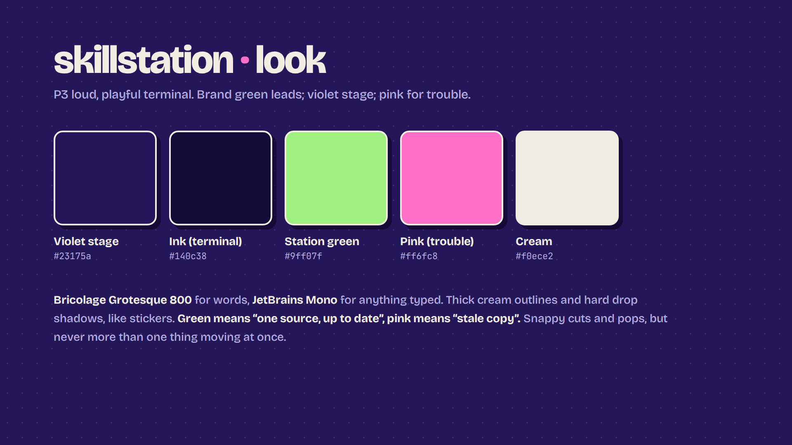
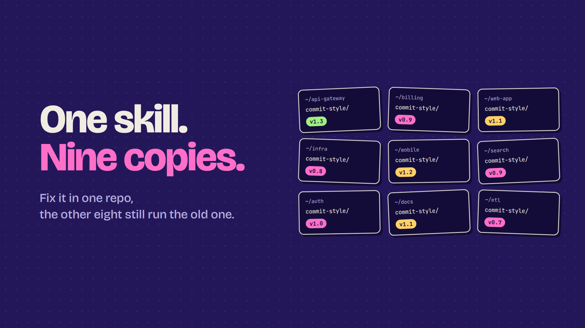
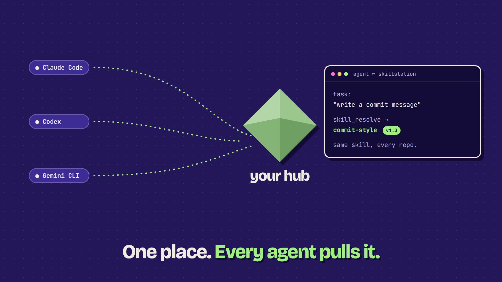
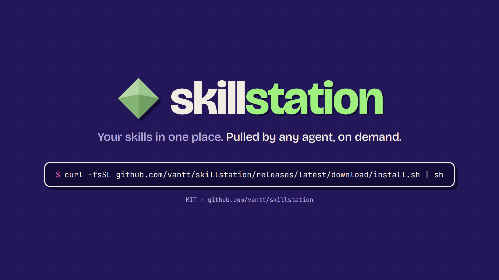
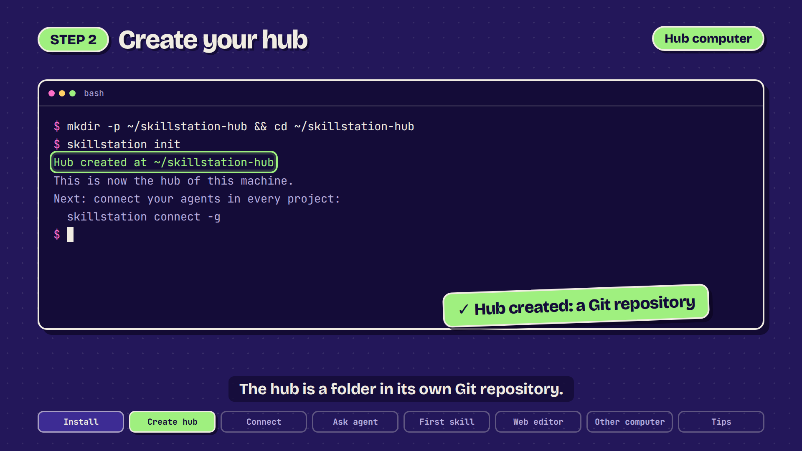
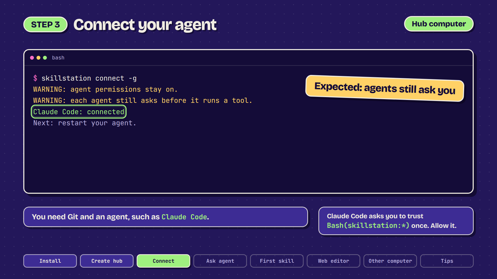
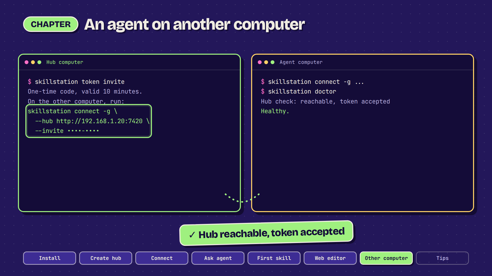
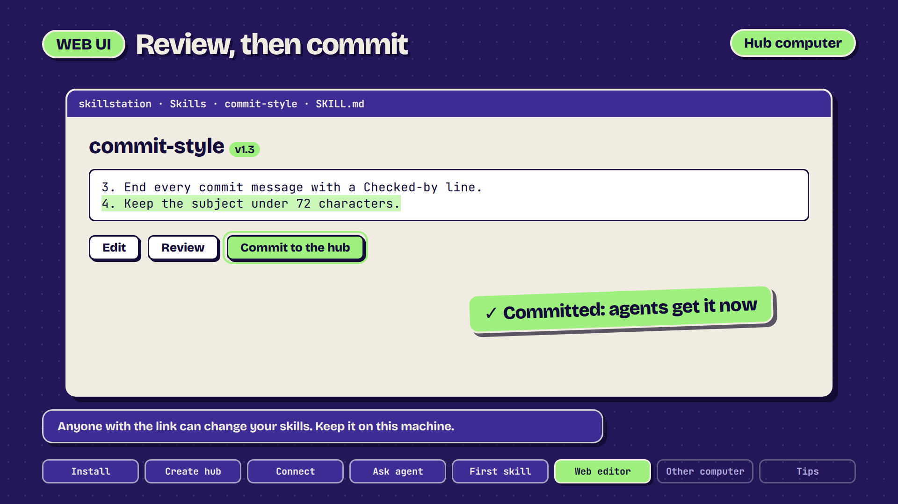
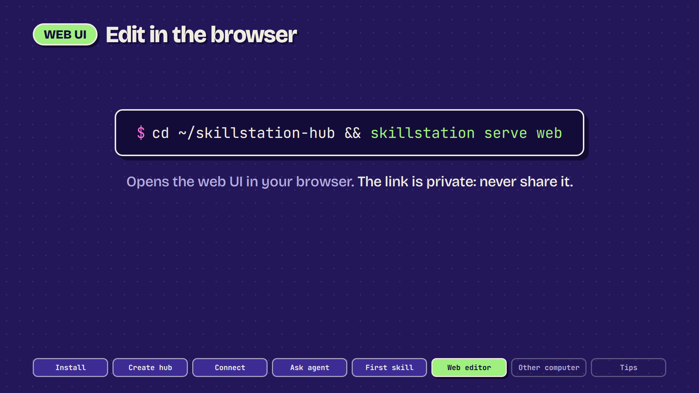

# Style frames: P3 look for both films

Still frames for the new look, copied from the vlog repo (2026-10-27). **Not yet approved by the owner.** Palette:
deep purple background, logo green as the main colour, pink as the second. Green = one source, the latest version;
pink = an old copy. Fonts: Bricolage Grotesque 800 and JetBrains Mono. Thick cream outlines, solid sticker shadows.

| Frame | Idea |
|---|---|
|  | Palette, fonts, rules |
|  | Hook: one skill, nine copies, versions drift |
|  | Middle: one hub, every agent gets the same skill |
|  | End: logo, tagline, install command |
|  | Tutorial: step title, machine label, highlight box, ✓ callout, subtitle, chapter progress |
|  | Tutorial: lower-third note, "expected warning" card, tip card |
|  | Tutorial: two computers (hub green, agent yellow), invite line |
|  | Tutorial: web UI frame, button highlight, result callout |
|  | Tutorial: command card for `serve web` (never film the link) |

Frames `t1`–`t5` are for the tutorial (film 2), **not yet approved**: terminal step with highlight, callout and
chapter progress bar with an "Ask agent" step (`t1`), notes and expected-warning card (`t2`), two computers with machine labels (`t3`), web UI
frame (`t4`), command card (`t5`). Hub = green label, agent = yellow label.

The terminal in the frames is HTML built to show the look. In the films the agent is recorded for real, then themed
with these colours. Names, hosts and versions in the frames are invented. The install command in `s3` drops
`https://` to fit; check it before use.

Rebuild (`frames.html` has one `<section class="frame" id="...">` of 1920×1080 per frame):

```bash
node video/style/render.mjs video/style/frames.html video/style
```

## Feedback

| Round | Date | Frame | Feedback | Handling |
|---|---|---|---|---|
